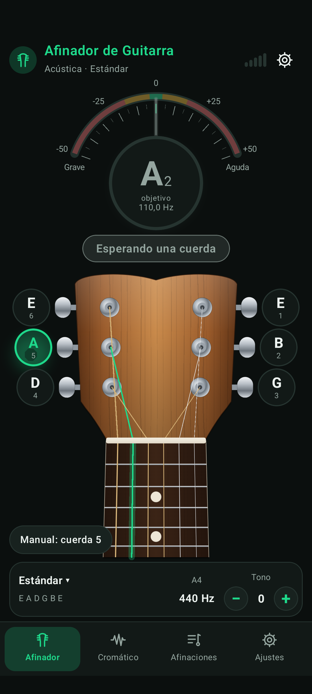
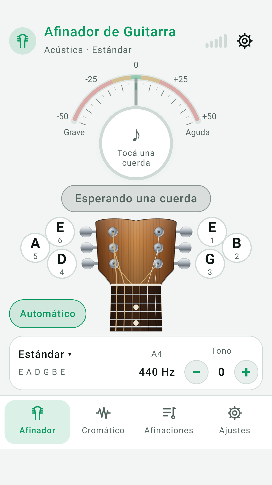
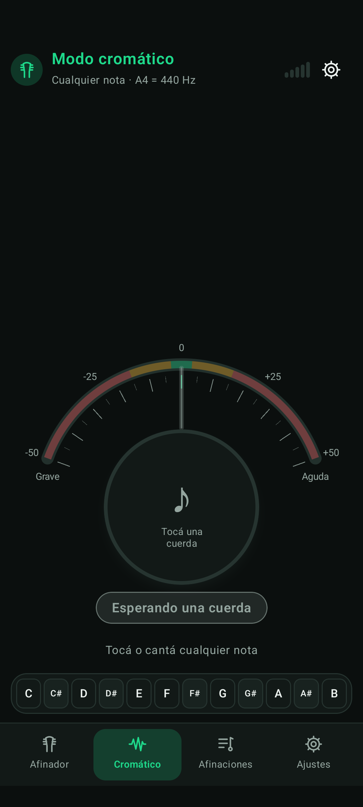

# Afinador Acústico

Afinador de guitarra acústica de seis cuerdas para Android: usa el micrófono del teléfono, funciona
sin conexión, no tiene publicidad ni cuentas y no pide permiso de Internet.

## Instalación en el celular

1. En el teléfono, abrí **Releases** del repositorio
   (`https://github.com/georgestrike25-afk/App-pc-finazas/releases`) y entrá a la más reciente
   **Afinador Acústico 1.0.N**.
2. Descargá `AfinadorAcustico-1.0.N.apk` (no el `-debug`).
3. Abrí el archivo descargado. Si Android lo pide, permití **Instalar apps desconocidas** para el
   navegador o el gestor de archivos.
4. Al abrir la app, seguí el tutorial y aceptá el permiso de **micrófono**.

> Si ya tenías instalada una versión anterior firmada con otra clave, Android no deja actualizar:
> desinstalá la anterior primero (ver «Firma» más abajo).

Requisitos: Android 8.0 (API 26) o superior, con micrófono.

<p>
  
  
  
</p>

Capturas reales tomadas en el emulador durante las pruebas de CI.

## Funciones

| Función | Detalle |
|---|---|
| Pantalla principal | Clavijero y mástil dibujados (madera, clavijas metálicas, cejuela, trastes y marcadores), seis botones de cuerda con nota y número, cuerda activa iluminada y vibrando con el color del estado, nota grande con octava, Hz medidos y cents, medidor en arco de −50 a +50 cents y estado textual («Demasiado grave», «Un poco grave», «¡Afinada!», «Un poco aguda», «Demasiado aguda», «Esperando una cuerda»). |
| Detección | Automática de la cuerda (con histéresis) o manual tocando un botón de cuerda. |
| Referencia A4 | 440 Hz (predeterminada), 432 Hz, ±1 Hz o valor libre entre 400 y 480 Hz; botón para volver a 440. Recalcula los objetivos reales de todas las cuerdas y del modo cromático. |
| Calibración | Mide una nota de un instrumento de referencia y propone la A4 correspondiente. |
| Transposición | Botones − / + (pantalla principal y Ajustes), de −12 a +12 semitonos, «Volver a 0». Se combina con la A4: objetivo = A4 · 2^((nota + transposición − 69)/12). |
| Afinaciones | Estándar, Medio tono abajo, Un tono abajo, Drop D, Drop C, Open D, Open G, Open C, Open E y DADGAD; crear, editar, duplicar y eliminar personalizadas (se guardan en el teléfono). |
| Modo cromático | Cualquier nota con sostenidos y octava, frecuencia medida y objetivo, cents y tira de las 12 notas. |
| Ajustes | Sensibilidad del micrófono, margen de «Afinada» (±1/2/3/5 cents), tema Sistema/Claro/Oscuro, mostrar cents, mantener pantalla encendida, tutorial, privacidad y acerca de. Todo persiste al cerrar la app. |

## Arquitectura

```
afinador-acustico/
├── core/   Kotlin puro (sin Android): toda la lógica de audio y música, probada en la JVM
│   ├── NoteMath.kt        escala temperada, cents, nombres de notas, límites de A4 y transposición
│   ├── Tuning.kt          afinaciones y objetivos por cuerda
│   ├── CustomTunings.kt   formato de guardado y operaciones de afinaciones personalizadas
│   ├── TunerEngine.kt     ventana deslizante, filtros, YIN, estabilizador y selección de cuerda
│   └── dsp/               FFT, YIN, pasa altos, pasa bajos Butterworth, estabilizador
└── app/    Android (Kotlin + Jetpack Compose)
    ├── audio/AudioInput.kt          captura con AudioRecord en un hilo de audio dedicado
    ├── data/SettingsRepository.kt   DataStore (ajustes y afinaciones personalizadas)
    ├── TunerViewModel.kt            une audio, motor y ajustes
    └── ui/                          pantallas, clavijero/mástil (Canvas), medidor, tema claro/oscuro
```

**Motor de afinación.** El micrófono entrega bloques PCM de 16 bits (48 kHz o 44,1 kHz según el
equipo). Cada bloque pasa por un pasa altos de 35 Hz y un pasa bajos Butterworth de 4.º orden
(corte = 3 × la cuerda más aguda, entre 700 Hz y 2 kHz). Cada ~21 ms se analiza una ventana de
4096 muestras (~85 ms) con **YIN** calculado por FFT (O(n log n)), con interpolación parabólica.
Un estabilizador (mediana de 5, confirmación de 2 bloques para cambiar de nota, suavizado
exponencial en cents, retención de 0,5 s) evita saltos; el ataque de la púa se descarta.
El micrófono sólo está abierto en Afinador/Cromático (o al calibrar) con la app visible.

## Compilar

```bash
cd afinador-acustico
./gradlew :core:test                      # pruebas del motor (no requiere Android SDK)
./gradlew :app:assembleRelease            # requiere Android SDK (ANDROID_HOME)
./gradlew :app:connectedDebugAndroidTest  # pruebas de interfaz con emulador o teléfono
```

El workflow `.github/workflows/afinador-android.yml` hace todo esto en GitHub Actions y publica el
APK como Release.

## Firma

El APK de lanzamiento se firma en CI. Si el repositorio tiene los secretos
`AFINADOR_KEYSTORE_BASE64`, `AFINADOR_KEYSTORE_PASSWORD`, `AFINADOR_KEY_ALIAS` y
`AFINADOR_KEY_PASSWORD`, se usa esa clave permanente. Si no, cada compilación genera su propia
clave (que no se publica ni se guarda): el APK es válido, pero dos compilaciones distintas no se
pueden instalar una encima de la otra sin desinstalar antes.

Para tener una clave permanente (actualizaciones sin desinstalar), en una PC con Java:

```bash
keytool -genkeypair -keystore afinador.jks -alias afinador -keyalg RSA -keysize 4096 -validity 10000
base64 -w0 afinador.jks   # copiar el resultado en el secreto AFINADOR_KEYSTORE_BASE64
```

y cargar los cuatro secretos en GitHub → Settings → Secrets and variables → Actions.
Guardá `afinador.jks` y su contraseña en un lugar seguro: sin ellos no se pueden publicar
actualizaciones con la misma firma.

## Pruebas e informe

Ver [`docs/INFORME.md`](docs/INFORME.md) para los resultados reales de compilación y pruebas.
